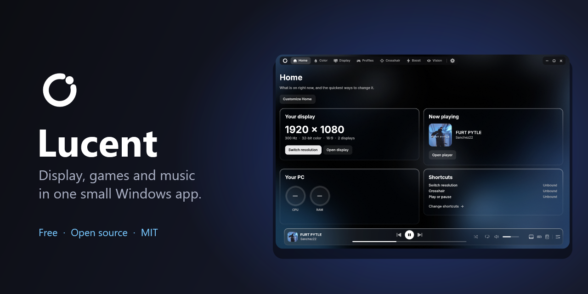
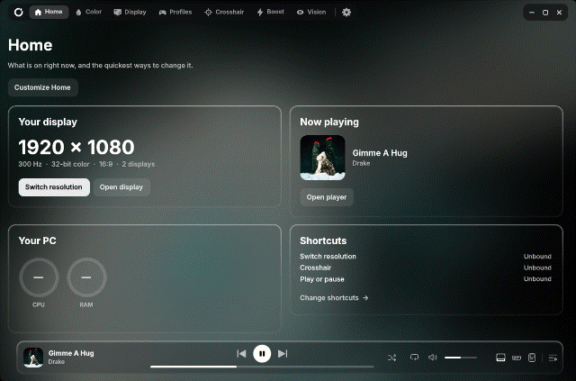
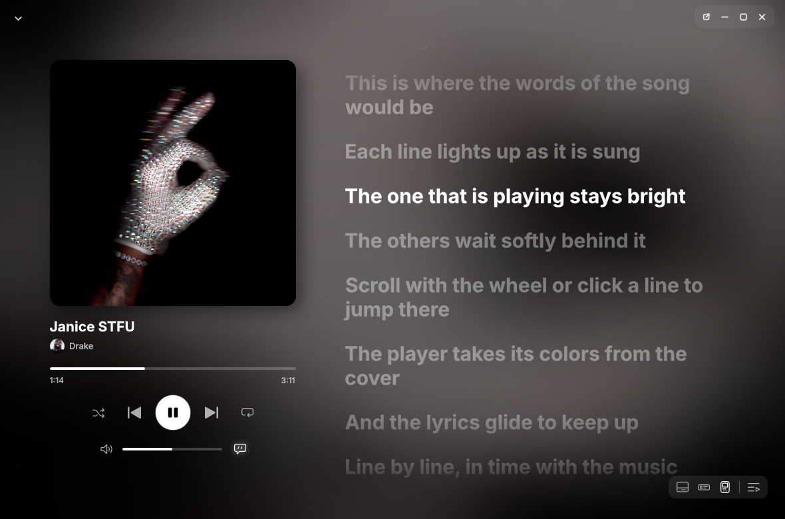
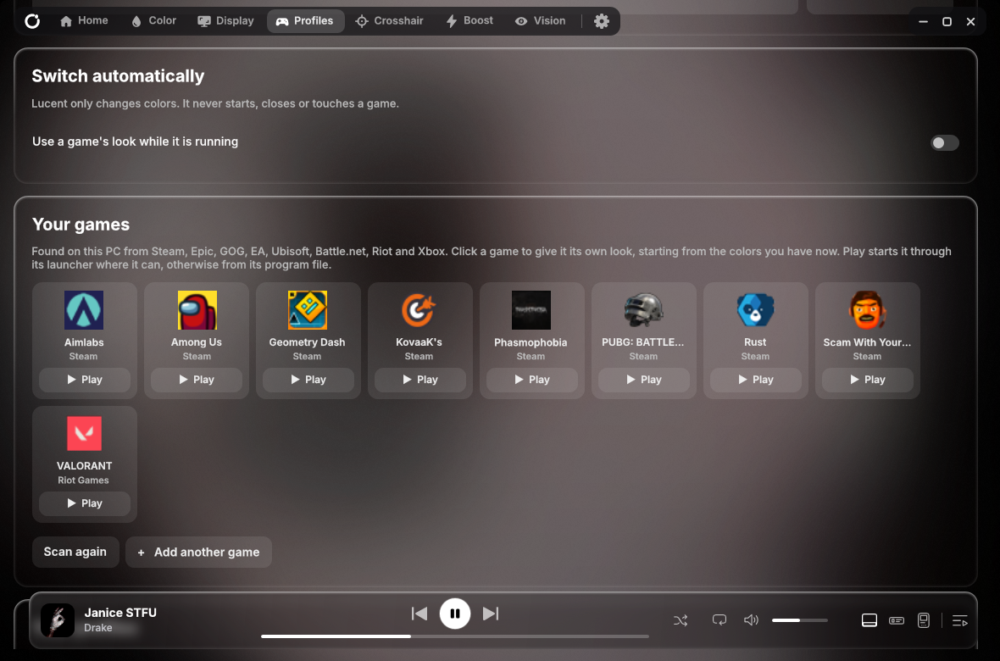
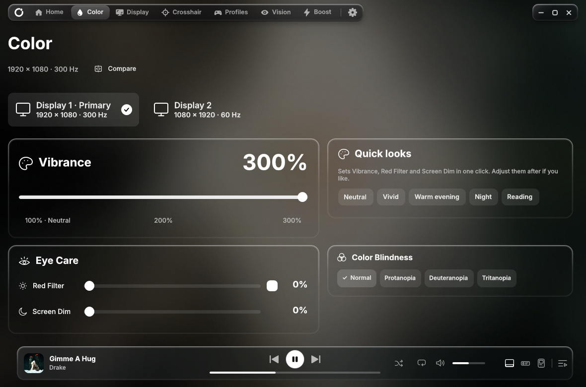
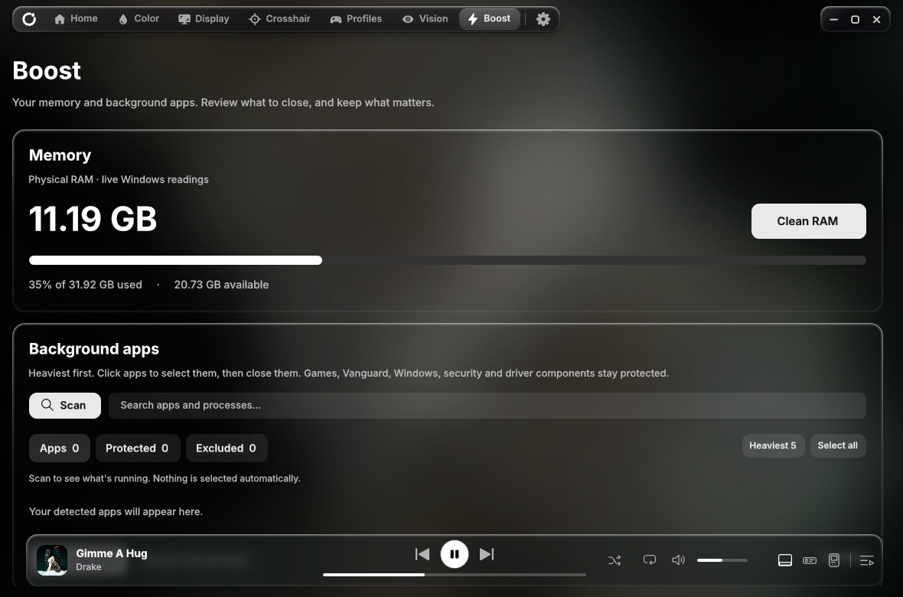

 

### Lucent
**Display, games and music in one small Windows app. Up to 300% vibrance.**

Free and open source (MIT) · Windows 10 / 11 · **[Download Lucent-Setup.exe](https://github.com/positted/lucent/releases/latest/download/Lucent-Setup.exe)**

## What it does

- **Vibrance up to 300%**, a red filter, screen dimming and color-blindness modes, for each display
- **Resolution and refresh rate** switching with a click or a shortcut
- **Profiles**: save your settings, or tie them to a game and Lucent switches while it runs
- **Crosshair, zoom, Dark Boost, Color pop and a sound radar**
- **Boost**: see what uses memory and close only what you pick
- **A player** with synced lyrics, a floating mini player and Discord Rich Presence
- **Colors that follow the music**: the whole app takes its colors from the album that is playing

<table>
<tr>
<td align="center"> The player</td>
<td align="center"> Profiles</td>
</tr>
<tr>
<td align="center"> Color</td>
<td align="center"> Boost</td>
</tr>
</table>

Lyrics and the PC numbers in the pictures are made up for the pictures. Album covers and game pictures belong to their artists, labels and publishers.

## Questions

<b>Windows or my antivirus warns about the setup. Why?</b>

 
Lucent is a small app by one person and is not code-signed yet, so Windows SmartScreen shows "unknown publisher" and a few antivirus engines flag it by guesswork (machine learning, not a named virus). Nothing in Lucent sends your data anywhere or touches your files. The whole source is here, so you can read it or build it yourself with <code>source/build-local.cmd</code>. If your antivirus flags it, please <a href="https://github.com/positted/lucent/issues">open an issue</a> with the detection name.

<b>Will it get me banned in a game?</b>

 
Lucent never reads or injects into a game and never touches anti-cheat such as Vanguard. It only changes your display and colors, and only when you ask.

<b>What does it send over the internet?</b>

 
Only the update check (GitHub's latest release for this repository, which you can turn off), the lyrics and artist pictures if you switch them on (lrclib.net and Deezer), and Discord Rich Presence through your own Discord app. No account, no tracking.

<b>For developers</b>

 
WPF, C# 5, .NET Framework 4.8. Build with <code>source/build-local.cmd</code>, then run <code>source/test-local.cmd</code> (logic) or <code>source/test-ui.cmd</code> (the UI in test mode). The source is in <code>source/</code> and the tests in <code>tests/</code>. See <a href="CONTRIBUTING.md">CONTRIBUTING</a> and <a href="THIRD-PARTY-NOTICES.md">THIRD-PARTY-NOTICES</a>.

## License

[MIT](LICENSE). Made by [@positted](https://github.com/positted), with [Claude](https://claude.com/claude-code) as a contributor. [Report a bug](https://github.com/positted/lucent/issues) or say hello in [Discussions](https://github.com/positted/lucent/discussions).