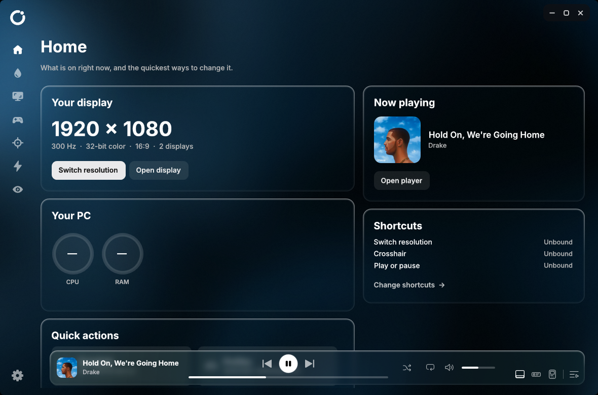

# Lucent

**A small Windows app I made for the things I kept fiddling with: my display, my games and my music.**
**Its colors come from the album that is playing.**

[**Download Lucent 1.1126**](https://github.com/positted/lucent/releases/latest) &nbsp;·&nbsp; Windows 10 / 11 &nbsp;·&nbsp; installs for your user, no admin prompt

 

 

## Why I made Lucent

I built Lucent because I was tired of opening five different tools to change resolution, tweak colors before a game, set up a crosshair and skip a song. It is one window, it stays out of your way, and it never touches a game while you are playing it.

I write and test it myself on my own PC, so if something looks off or breaks on yours, [open an issue](https://github.com/positted/lucent/issues) and I will look at it.

## What you get

- **Resolution and refresh rate.** Switch with a click or a shortcut, keep two sizes as a quick-switch pair, add custom resolutions, choose how a lower resolution fills the screen. Your refresh rate and color depth stay the same, and nothing is applied when Lucent starts.
- **Color.** Vibrance, a red filter and screen dimming for each display, quick looks (Vivid, Warm evening, Night, Reading) and eye-break reminders.
- **Game profiles.** A saved look for each game. While the game runs Lucent uses its look, then goes back to your desktop look.
- **Crosshair.** Build your own, save it, share it with a short code.
- **Zoom and visual tools.** Zoom with the mouse wheel, Smart shadows, Color pop and a sound radar.
- **Game Boost.** See what is using memory and close only what you pick. Games, anti-cheat, Windows and security parts are never touched.
- **Music.** A glass player bar, a full-window player with synced lyrics, a mini player that floats above your games, and Discord Rich Presence.
- **Looks.** Custom GIF backgrounds, a see-through glass interface, and a Performance mode that turns off everything that is only for show.

## Colors that follow the music

The window, the cards and the moving colors behind them are made from the cover that is playing. A blue cover gives a blue app, a red one a red app. A cover with a small patch of another color (a face on a blue sky) still gives its main color.

## The player

Lyrics show line by line in time with the song. (The lines in this picture are made up for the picture.)

## Your games

## More

## Install

1. Download `Lucent-Setup-1.1126.exe` from the [latest release](https://github.com/positted/lucent/releases/latest).
2. Run it. It installs for your user and does not ask for permission. Only the optional CPU temperature support does.
3. Open Lucent from the Start menu. Closing the window sends it to the tray (you can change that in Settings).

Lucent tells you in About, on Home and in the tray when a newer version is published here. The button opens only a page of this repository.

## What I promise it will not do

- It will not apply a display mode when it starts. Your settings stay in `%LOCALAPPDATA%\lucent`.
- Boost closes only what you select, checks each process again first, and never touches games, Vanguard, Windows, security or driver components. A window that stays open may be asking to save, so it is never force-closed.
- It will not read a game's memory or modules. Process paths use limited query rights only.
- Lyrics, artist pictures and Discord Rich Presence are off until you switch them on. Lyrics look the song up on lrclib.net, and artist pictures use Deezer's public search.

## Versions

Release names are `1.MMYY`, the month and year of the release (November 2026 is `1.1126`). A second build in the same month is `1.1126.2`, then `.3`.

 

<b>For developers: build, test and source layout</b>

 

### Build and test

Build only with `source/build-local.cmd`. It compiles with the Framework64 `csc.exe` into `release/`. Do not use the original `legacy/build.cmd`, which copies over an older release.

Run these from `source/`:

| Script | Covers |
|---|---|
| `test-ui.cmd` | The UI in test mode: pages, settings, player, shortcuts, adaptive color, recovery |
| `test-local.cmd` | Color math, profiles, persistence, process protections, RAM trimming on a fixture |
| `test-boost.cmd` | Boost safety, closing only disposable fixtures |
| `test-tabs.cmd` | Frame timing while changing tabs: frames drawn and the longest stall |
| `test-background.cmd` | GIF decoding and playback |
| `test-resize-live.cmd`, `test-mini-lyrics-bench.cmd` | Real-window measurements: what each step of resizing costs, and how steadily the mini player redraws while its lyrics open and close |
| `test-glass-live.cmd`, `test-readme-shots.cmd` | Screenshots of the real window, for looking at the glass and for the pictures above |

Each release is its own versioned folder holding `Lucent.exe`, its icon, the SharpDX DLLs and license, and `fonts/`. No ZIP or preview images.

### Where things live

`source/` holds the app (WPF, C# 5, .NET Framework 4.8). `Shell` is the main window, split by feature: `App.cs` (entry, window setup), `ShellChrome.cs` (sidebar, surfaces, player buttons), `ShellMotion.cs` (tab changes, window motion), `ShellHome.cs`, `ShellVideo.cs`, `ShellResolution.cs`, `ShellProfiles.cs`, `ShellCrosshair.cs`, `ShellVisualTools.cs`, `ShellBackgrounds.cs`, `ShellSettings.cs` (one page each), `ShellBoost.cs`/`ShellMemory.cs` (Boost), `GpuZoom.cs` and `SoundRadar.cs` (overlays), `MediaSession.cs`/`PlayerCore.cs`/`PlayerBar.cs`/`BigPlayerView.cs`/`MediaPlayerWindow.cs`/`LyricsView.cs` (the players), `AmbientBackdrop.cs`/`FlowingBackdrop.cs`/`BarBackdrop.cs` (the colors that follow the cover), `DesignSystem.cs` (styles, icons, glass edge), `State.cs` (preferences and recovery).

`source/legacy/` is the original WinForms code. Display modes, hotkeys, the crosshair overlay, NVIDIA scaling and process identity still come from it.

### Setup and CPU temperature

`installer/LucentSetup.cs` builds `Lucent-Setup-<version>.exe` (`build-installer.ps1`): the app and the sensor helper are inside it. `source/sensors/LucentSensors.cs` is the helper; it uses LibreHardwareMonitorLib (MPL-2.0) and its dependencies (licenses in `source/lib/sensors`). Setup downloads the official signed PawnIO installer (GPL-2.0 driver) pinned to one version and hash, and creates the scheduled task that starts the helper. HWiNFO is proprietary and is not used.

 

The album covers in the pictures belong to their artists and labels. They are shown only to demonstrate how Lucent takes its colors from artwork.
