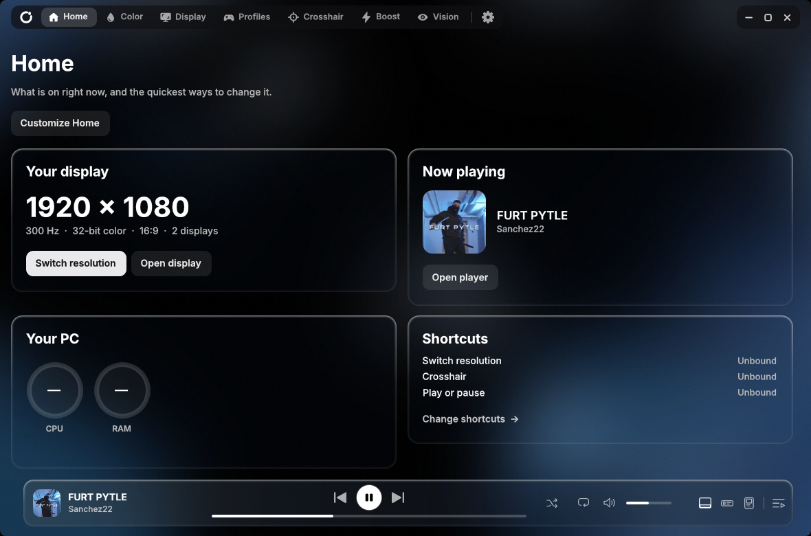
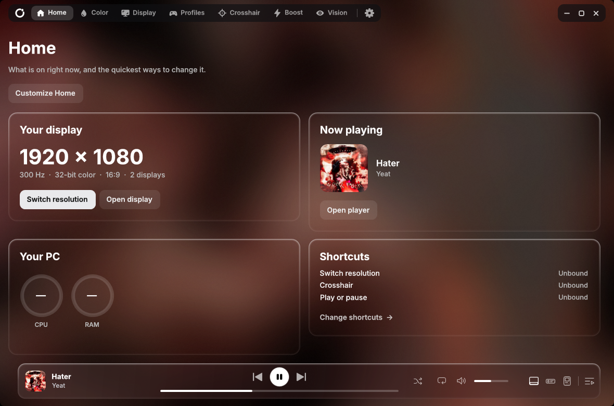
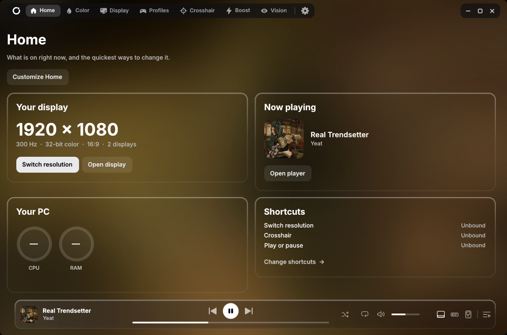
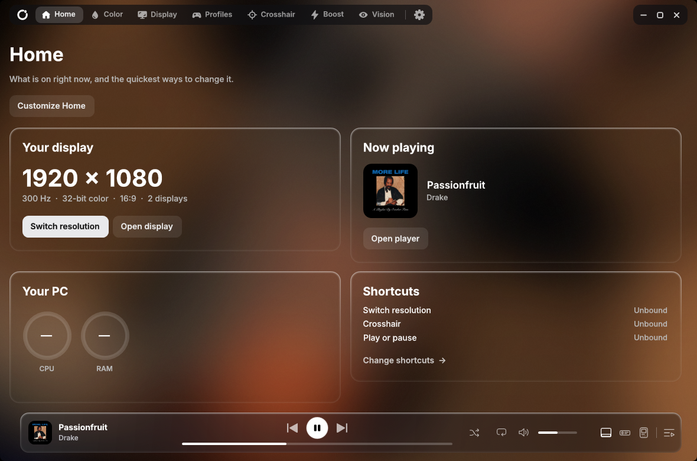
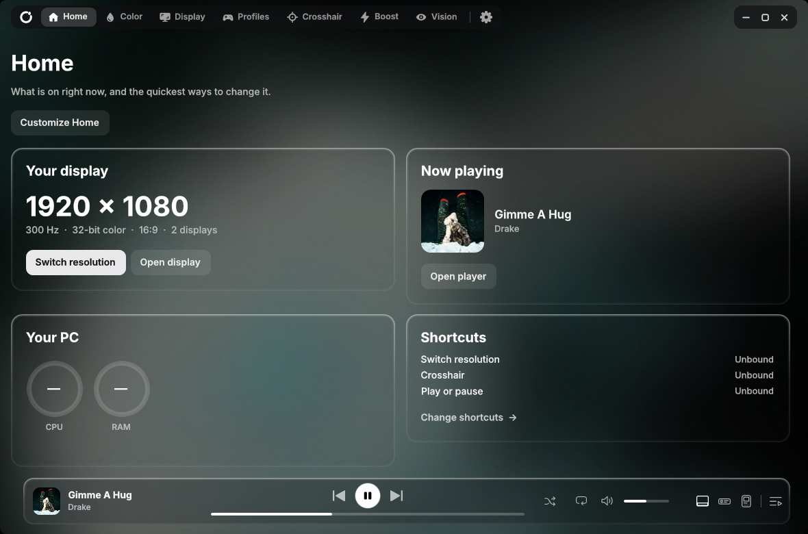
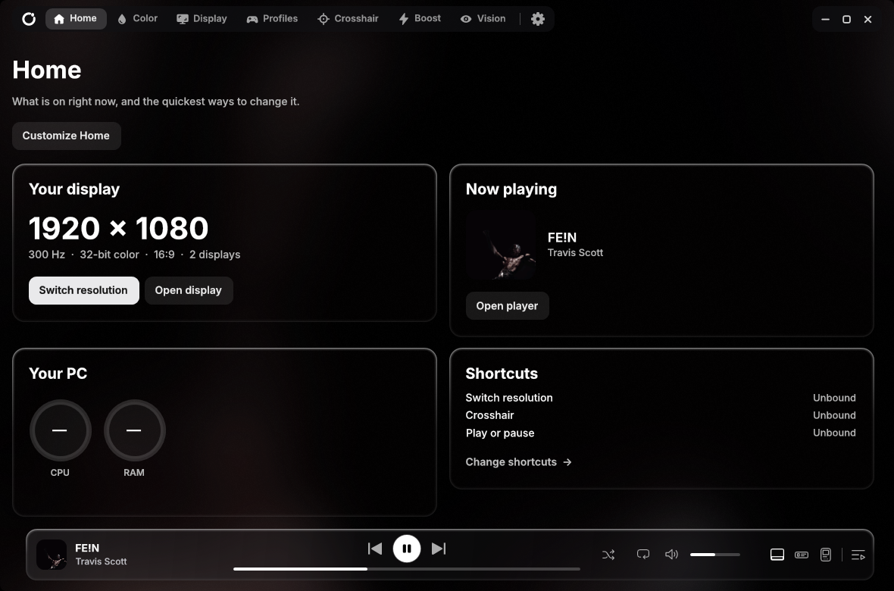
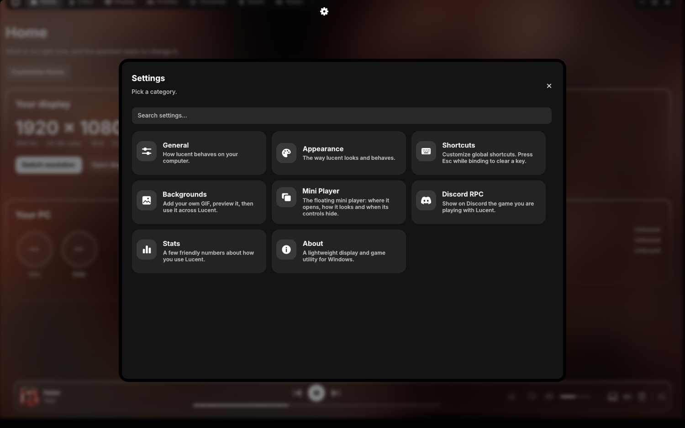
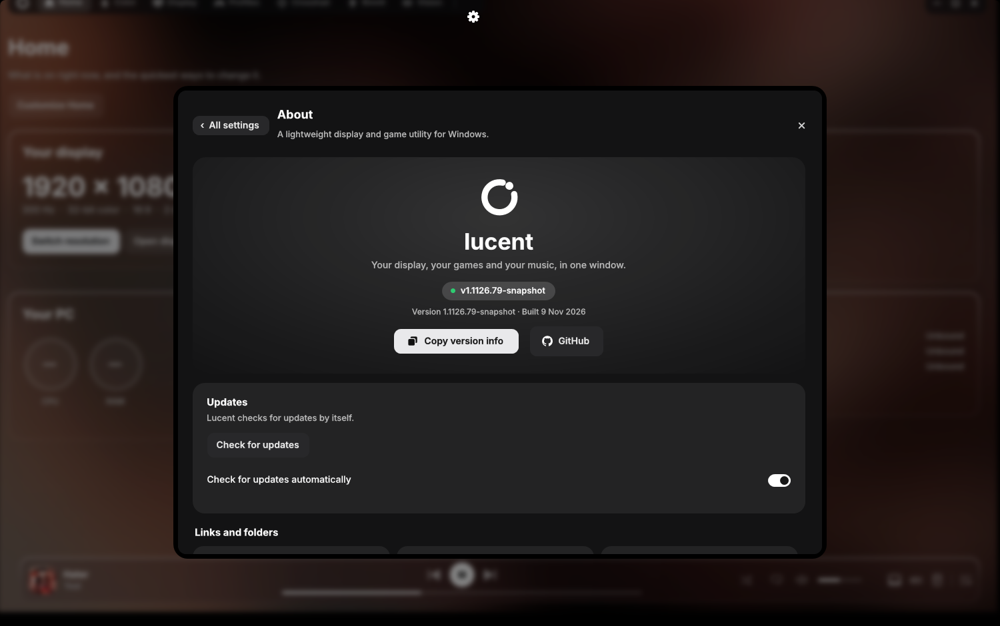

 

### *Lucent. The Windows app that makes your setup feel like yours.*

A small app I made for the things I kept fiddling with: my display, my games and my music.
Its colors come from the album that is playing.

<b>Download coming soon</b> &nbsp;·&nbsp; Windows 10 / 11 &nbsp;·&nbsp; installs for your user, no admin prompt

   

 &nbsp; 

<!-- Discord server not made yet: the community banner points to GitHub Discussions for now. Swap the link for the invite later. -->
<!-- TODO GIFs (need a live recording): docs/images/mini-player-close.gif, docs/images/dark-boost-scroll.gif -->

 

## Why I made Lucent

I built Lucent because I was tired of opening five different tools to change resolution, tweak colors before a game, set up a crosshair and skip a song. It is one window, it stays out of your way, and it never touches a game while you are playing it.

Lucent is **free and open source (MIT)**. There is no account, no ads and nothing locked away. If you like it and want to help, there is an optional [Ko-fi](https://ko-fi.com/lucent_), but you never have to.

I write and test it myself on my own PC, so if something looks off or breaks on yours, [open an issue](https://github.com/positted/lucent/issues) and I will look at it.

## What you get

| | |
|---|---|
| **Resolution and refresh rate** | Switch with a click or a shortcut, keep two sizes as a quick-switch pair, add custom resolutions. Your refresh rate and color depth stay the same, and nothing is applied when Lucent starts. |
| **Color** | Vibrance, a red filter and screen dimming for each display, quick looks (Vivid, Warm evening, Night, Reading), color-blindness modes with a strength slider and eye-break reminders. |
| **Profiles** | Save your colors, Dark Boost, zoom, Color pop and sound radar as a profile, and use it any time. Tie one to a game and it switches on while that game runs, then goes back to your desktop look. |
| **Crosshair** | Build your own, save it, share it with a short code. |
| **Zoom and visual tools** | Zoom with the mouse wheel, Smart shadows, Dark Boost (hold its key and scroll to change the strength), Color pop and a sound radar. |
| **Game Boost** | See what is using memory and close only what you pick. Games, anti-cheat, Windows and security parts are never touched. |
| **Music** | A glass player bar, a full-window player with synced lyrics, a mini player that floats above your games, and Discord Rich Presence. |
| **Looks** | Custom GIF backgrounds, a see-through glass interface, and a Performance mode that turns off everything that is only for show. |

## Colors that follow the music

Put a song on and Lucent changes with it. Every album cover gives the window its own mood. Lucent looks at the whole cover and goes with the color there is the most of, so one small patch of another color will not take over.

<table>
<tr>
<td align="center"> Sanchez22, FURT PYTLE</td>
<td align="center"> Yeat, Hater</td>
<td align="center"> Yeat, Real Trendsetter</td>
</tr>
<tr>
<td align="center"> Drake, Passionfruit</td>
<td align="center"> Drake, Gimme A Hug</td>
<td align="center"> Travis Scott, FE!N</td>
</tr>
</table>
## Take a look

<table>
<tr>
<td align="center"> The big player</td>
<td align="center"> Lyrics in time with the song</td>
<td align="center"> Your games, found for you</td>
</tr>
<tr>
<td align="center"> Settings</td>
<td align="center"> About</td>
<td align="center"> Display</td>
</tr>
</table>

The lyrics in that picture are made up for the picture.
## Install

The first download is coming soon. Star or watch this repository to hear when it is out.

When it is, installing will be three steps: download the setup, run it (it installs for your user and does not ask for permission), then open Lucent from the Start menu. Closing the window sends it to the tray (you can change that in Settings).

Lucent will tell you in About, on Home and in the tray when a newer version is published here.

> **Windows says "unknown publisher"?** Lucent is a small free app and is not code-signed yet, so Windows or your antivirus may be careful with it. The whole source is in this repository, so you can read it or build it yourself (see below).

## What I promise it will not do

- It will not apply a display mode when it starts. Your settings stay in `%LOCALAPPDATA%\lucent`.
- Boost closes only what you select, checks each process again first, and never touches games, Vanguard, Windows, security or driver components. A window that stays open may be asking to save, so it is never force-closed.
- It will not read a game's memory or modules. Process paths use limited query rights only.
- Lyrics and artist pictures are off until you switch them on. Lyrics look the song up on lrclib.net, and artist pictures use Deezer's public search. Discord Rich Presence is on by default (it shows the game you are playing on your Discord profile) and you can turn it off in Settings, Discord RPC.

## FAQ

**Why does Windows warn me when I run the setup?**
Lucent is a small free app made by one person, and it is not code-signed yet (a certificate costs money, and I am looking at free signing for open source). Windows SmartScreen and some antivirus programs are careful with new, unsigned files, so you may see "unknown publisher" or, rarely, a false alarm. The whole source is in this repository. You can read it, or build it yourself with `source/build-local.cmd`. Every release will list its SHA-256 checksum and a [VirusTotal](https://www.virustotal.com) scan link, so you can check the file yourself before you run it (you can also drop the setup onto virustotal.com any time). If your antivirus flags it, please [open an issue](https://github.com/positted/lucent/issues) with the version number.

**Is it really free?**
Yes. No account, no ads, no locked features, MIT license. Ko-fi is optional.

**Will it get me banned in a game?**
Lucent never reads a game's memory or injects into a game, and it never touches anti-cheat such as Vanguard. It changes your display and colors the way Windows allows, and only when you ask.

**Does it need administrator rights?**
No. Setup installs for your user only.

**Does it send my data anywhere?**
No account and no tracking. The only network use is the update check (it asks GitHub for this repository's latest release, and you can switch it off) and the features you turn on yourself: lyrics (lrclib.net) and artist pictures (Deezer). Discord Rich Presence talks to your own Discord app on this PC, and Lucent reads Discord's public list of games to find a game's picture.

**Where are my settings, and how do I remove Lucent?**
Settings live in `%LOCALAPPDATA%\lucent`. Uninstall from Windows Settings → Apps.

## Join the community

Ask questions, share your game profiles and crosshair codes, and tell me what to build next. A Discord server is coming. Until then, the [Discussions tab](https://github.com/positted/lucent/discussions) is the place.

## Support Lucent

Lucent is free and stays free. If it saved you some time, you can [buy me a coffee on Ko-fi](https://ko-fi.com/lucent_). Starring the repository, reporting bugs and telling a friend help just as much.

## Credits

Made by [@positted](https://github.com/positted), with [Claude](https://claude.com/claude-code) (Anthropic) as a contributor on the code, tests and this page.

Lucent uses [SharpDX](https://github.com/sharpdx/SharpDX) (MIT). The album covers and game pictures in the screenshots belong to their artists, labels and publishers, and are shown only to demonstrate the app.

## License

[MIT](LICENSE). Do what you like with it, just keep the notice. The full source, tests and installer are in this repository. See [CONTRIBUTING](CONTRIBUTING.md) to help and [THIRD-PARTY-NOTICES](THIRD-PARTY-NOTICES.md) for the libraries it uses.

 

<b>For developers: build, test and source layout</b>

 

### Build and test

Build only with `source/build-local.cmd`. It compiles with the Framework64 `csc.exe` into `release/`. Do not use the original `legacy/build.cmd`, which copies over an older release.

Run these from `source/`:

| Script | Covers |
|---|---|
| `test-ui.cmd` | The UI in test mode: pages, settings, player, shortcuts, adaptive color, recovery |
| `test-local.cmd` | Color math, profiles, persistence, process protections, RAM trimming on a fixture |
| `test-boost.cmd` | Boost safety, closing only disposable fixtures |
| `test-tabs.cmd` | Frame timing while changing tabs: frames drawn and the longest stall |
| `test-background.cmd` | GIF decoding and playback |
| `test-resize-live.cmd`, `test-mini-lyrics-bench.cmd` | Real-window measurements: what each step of resizing costs, and how steadily the mini player redraws while its lyrics open and close |
| `test-glass-live.cmd`, `test-readme-shots.cmd` | Screenshots of the real window, for looking at the glass and for the pictures above |

Releases are published on the Releases page as a single setup file.

### Where things live

`source/` holds the app (WPF, C# 5, .NET Framework 4.8). `Shell` is the main window, split by feature: `App.cs` (entry, window setup), `ShellChrome.cs` (sidebar, surfaces, player buttons), `ShellMotion.cs` (tab changes, window motion), `ShellHome.cs`, `ShellVideo.cs`, `ShellResolution.cs`, `ShellProfiles.cs`, `ShellCrosshair.cs`, `ShellVisualTools.cs`, `ShellBackgrounds.cs`, `ShellSettings.cs` (one page each), `ShellBoost.cs`/`ShellMemory.cs` (Boost), `GpuZoom.cs` and `SoundRadar.cs` (overlays), `MediaSession.cs`/`PlayerCore.cs`/`PlayerBar.cs`/`BigPlayerView.cs`/`MediaPlayerWindow.cs`/`LyricsView.cs` (the players), `AmbientBackdrop.cs`/`FlowingBackdrop.cs`/`BarBackdrop.cs` (the colors that follow the cover), `DesignSystem.cs` (styles, icons, glass edge), `State.cs` (preferences and recovery).

`source/legacy/` is the original WinForms code. Display modes, hotkeys, the crosshair overlay, NVIDIA scaling and process identity still come from it.

